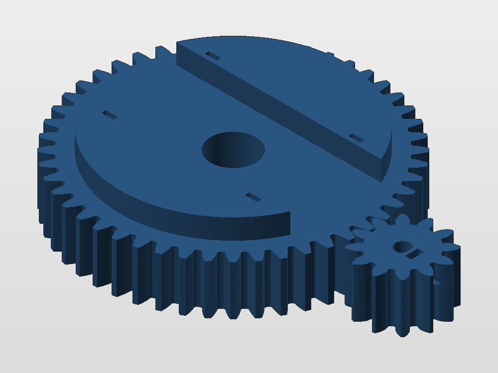

# pecas-3d

Plugin do Claude Code para modelar peças de impressão 3D no FreeCAD por conversa. Você descreve a peça e passa as medidas; sai um projeto `.FCStd` com árvore editável, o STL para fatiar e o STEP.



O projeto não é uma malha morta: cada peça é um corpo do PartDesign com esboços restritos, e toda medida fica numa planilha. Abriu no FreeCAD, mudou a medida, Ctrl+R, a peça se refaz.

## Instalar

No Claude Code:

```
/plugin marketplace add MikaelDDavidd/pecas-3d
/plugin install pecas-3d@pecas-3d
```

Depois é só pedir: "faz um suporte de parede para um roteador de 18 x 3 cm". Na primeira vez o Claude pergunta se pode configurar o FreeCAD.

- **Linux** (x86_64 ou ARM, com glibc): baixa o FreeCAD 1.1.4 oficial (~800 MB, ocupa ~3 GB em `~/.local/share/pecas-3d`), confere o SHA256 e extrai sem sudo.
- **macOS**: usa o FreeCAD que já estiver instalado (`brew install --cask freecad` ou o .dmg do site). Qualquer 1.x serve; o testado é o 1.1.4.
- **Windows**: só pelo WSL2.

O único download é o do FreeCAD, direto do GitHub do projeto FreeCAD. Nada é enviado para lugar nenhum.

## O que ele confere

Toda peça passa por estas checagens antes de ser entregue:

- esboços sem grau de liberdade;
- cada peça um sólido válido, apoiado na mesa e sem invadir as outras;
- a árvore continua válida quando cinco medidas da planilha mudam;
- STL fechado, sem non-manifold e sem auto-interseção.

As regras de projeto (folgas, paredes, furos, porcas, insertos, materiais) estão em [`skills/pecas-3d/docs`](skills/pecas-3d/docs), com a fonte de cada número.

## Usar sem o Claude

Tudo passa por um script, que também roda sozinho:

```bash
git clone https://github.com/MikaelDDavidd/pecas-3d
cd pecas-3d
bash skills/pecas-3d/scripts/p3d setup
bash skills/pecas-3d/scripts/p3d nova suporte-roteador ~/pecas
bash skills/pecas-3d/scripts/p3d gerar ~/pecas/suporte-roteador/peca.py largura=180
bash skills/pecas-3d/scripts/p3d abrir ~/pecas/suporte-roteador/saida/suporte-roteador.FCStd
```

`--help` lista os comandos.

## Exemplos

- [Régua de folgas](skills/pecas-3d/exemplos/regua-folgas): pinos impressos já montados, para descobrir a folga que a sua impressora aguenta.
- [Engrenagem de registro](skills/pecas-3d/exemplos/engrenagem-registro): coroa e pinhão para motorizar um registro de PVC de 100 mm.

## Desenvolvimento

```bash
bash skills/pecas-3d/scripts/p3d testar
shellcheck skills/pecas-3d/scripts/p3d
```

O CI roda os dois em Linux x86_64 e ARM a cada push.

## Licença

MIT
