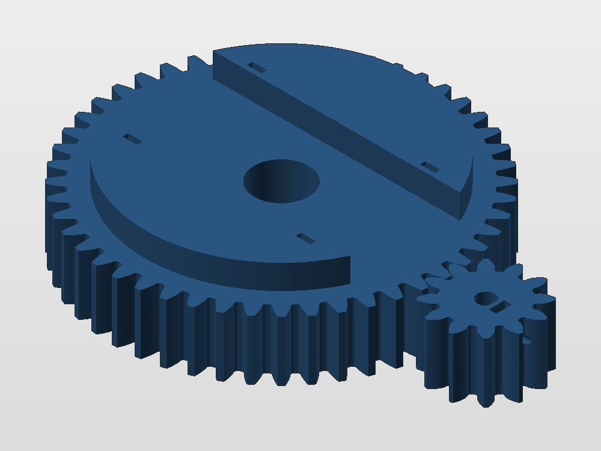

# Engrenagem para motorizar um registro

Par de engrenagens que abre e fecha por motor um registro de esfera de PVC de 100 mm com alavanca em T.



- **Coroa** (48 dentes): senta em cima da alavanca. O rasgo de baixo abraça o braço da alavanca e quatro canais verticais levam abraçadeiras de nylon que prendem a coroa no braço.
- **Pinhão** (12 dentes): vai no eixo do motor, com a face de cima encostada nele. Furo em D, trava por prisioneiro M3 (M3x8 ou M3x10) que entra por um vão entre dentes e porca M3 presa pela face do motor.

Relação 4:1: o registro gira 90 graus, então o motor dá uma volta por manobra.

## Medidas

| Item | Valor |
|---|---|
| Módulo | 2,5 (deslocamento de perfil +0,3 no pinhão, -0,3 na coroa) |
| Coroa | Ø externo ~123,5 mm, altura 31 mm |
| Pinhão | Ø externo ~38 mm, altura 22 mm |
| Distância entre centros | 75,6 mm (75 + 0,6 de folga entre dentes) |
| Rasgo da alavanca | 40,6 x 9 mm |
| Furo do eixo | Ø 6,35 com chato a 2,6 mm do centro |

Medidas marcadas `MEDIR` no `peca.py` são estimativas e mudam de registro para registro e de motor para motor: largura e espessura do braço da alavanca, furo do centro, diâmetro, chato e comprimento do eixo do motor.

## Resistência

Pela equação de Lewis no pinhão, com ASA a 14 MPa no pé do dente: até ~2,8 N.m no motor e ~11 N.m no registro. O ponto fraco é o chato do eixo D no plástico (~1,2 a 1,5 N.m); acima disso, usar flange metálica no eixo.

Para medir o torque do registro: balança de mala na ponta da alavanca, kg x 9,8 x distância em metros = N.m.

O motor precisa de fim de curso (chave ou limite de corrente). Travado contra o registro fechado, quebra o dente do pinhão.

## Material e impressão

- **ASA** (registro ao ar livre pega sol). PA-CF é melhor para engrenagem, se der para imprimir. PETG só na sombra.
- As duas peças com os dentes na mesa, sem suporte. A coroa vai virada ao contrário na alavanca.
- Pinhão com 100% de preenchimento; coroa com 6 perímetros e 40% giroide.
- Compensação de elephant foot de 0,2 mm, senão o pé dos dentes come a folga.
- ASA empena em impressora aberta: caixa ou tenda, mesa a 105-110 °C, ventoinha desligada, brim.

Antes da coroa inteira (~270 cm³), vale testar o engrenamento com o pinhão e uma fatia de 8 mm da coroa.

## Gerar e abrir

```bash
p3d gerar engrenagem-registro/peca.py [param=valor ...]
p3d abrir engrenagem-registro/saida/engrenagem-registro.FCStd
```

`giro_pinhao` na planilha é só visual (deixa os dentes engrenados na vista). Mudou dentes ou módulo na planilha: gere de novo pelo script para acertar.

O suporte do motor não faz parte do exemplo: ele segura o eixo do motor a 75,6 mm do eixo do registro, numa posição em que o braço da alavanca não passe por baixo do pinhão.
