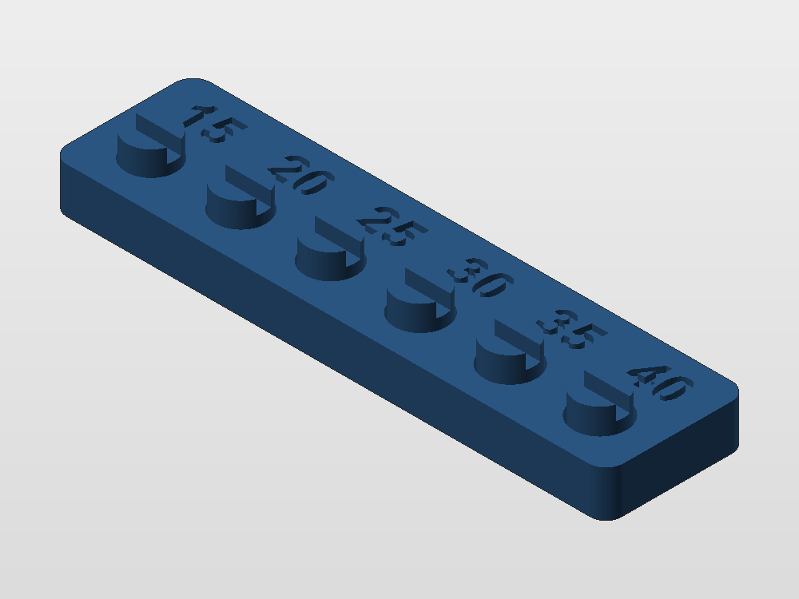

# Régua de folgas (print-in-place)

Peça de teste que mede a folga mínima que a sua impressora consegue em peças impressas já montadas. As folgas de `docs/tolerancias-encaixes.md` vêm de fontes externas e pedem calibração; esta é a peça para isso.



## Como funciona

- Placa de 93 x 24 x 8 mm com 6 pinos de 8 mm já montados dentro dela.
- Cada pino tem um **bulbo de cone duplo (45 graus)** preso num alojamento igual. O pino não sai da placa e tudo imprime sem suporte.
- O alojamento é o pino afastado da folga **na normal de todas as faces**, então a folga vale igual na parede reta e no cone.
- Os números gravados mostram a folga por lado em centésimos de mm: 15, 20, 25, 30, 35, 40, ou seja, de 0,15 a 0,40 mm.

## Como usar

1. Imprimir e esperar esfriar na mesa.
2. Girar cada pino com uma moeda ou chave de fenda na fenda do topo, começando pelo 40.
3. O **menor número que gira solto** (depois de quebrar a película com uma torção firme) é a folga print-in-place desta impressora com este filamento.
4. Anotar o resultado com a data e o filamento, e usar esse valor nas próximas peças print-in-place.

Nos cones de 45 graus o vão na vertical é a folga vezes 1,41 (0,21 mm no pino 15, 0,28 mm no 20). O doc pede pelo menos 0,3 mm em Z, então se o 15 e o 20 travarem, a causa provável é o cone. A folga de parede reta pode ser menor que o número que gira.

O valor de partida dos docs é 0,3 mm por lado. Se o 25 ou o 20 girarem, dá para apertar. PETG costuma pedir uns 0,1 mm a mais que PLA: vale imprimir de novo se trocar de filamento.

## Material e impressão

| Item | Valor |
|---|---|
| Material | PLA (é o filamento que você mais vai usar em encaixe; repetir com PETG se for usar PETG) |
| Orientação | como está no STL, placa deitada |
| Suporte | não |
| Altura de camada | 0,2 mm |
| Paredes | 4 |
| Infill | 15% (peça de teste, sem carga) |
| Compensação elephant foot | 0,2 mm |
| Brim | não (o brim só cola por fora, mas não ajuda em nada aqui) |
| Massa | 23 g a 100% de preenchimento; o fatiador dá o valor real com 15% |

Fio de PLA dentro do vão trava o pino e estraga a leitura: retração ligada, "evitar atravessar paredes" ligado e filamento seco.

A fenda do topo tem 2,4 mm de largura, para moeda ou chave de fenda. Os números têm cerca de 5,3 mm de altura e 1 mm de profundidade.

O STL usa malha de 0,01 mm, que come no máximo isso de cada lado da folga.

A base da placa, a boca dos alojamentos e a base dos pinos têm chanfro de 0,4 mm, então a primeira camada não emenda pino e placa.

## Abrir e editar no FreeCAD

```bash
p3d gerar regua-folgas/peca.py                                # padrão: 0,15 a 0,40
p3d gerar regua-folgas/peca.py folga_ini=0.3 folga_passo=0.1  # 0,3 a 0,8 (PETG)
p3d abrir regua-folgas/saida/regua-folgas.FCStd
```

A árvore tem a planilha `Medidas` e o grupo `PecasParaImprimir`, com a `PlacaGravada` e os pinos `Pino15` a `Pino40`. Para mudar uma medida, edite a planilha e recalcule (Ctrl+R); as folgas de cada pino são as linhas `folga1` a `folga6`.

- Os números gravados não acompanham a folga sozinhos: depois de mudar `folga_ini` ou `folga_passo` na planilha, edite o texto de `Numero1` a `Numero6` ou gere de novo pelo script.
- Para mudar a quantidade de pinos, gere de novo pelo script (`N` no topo do `peca.py`).

Além da validação padrão, o script confere que nenhum pino encosta na placa e que a distância medida entre cada pino e a placa é a folga pedida.
